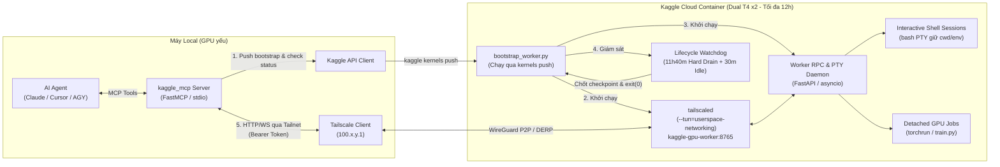

# Thiết kế Kiến trúc `kaggle_mcp`: Headless 12h GPU Worker & Remote Terminal cho AI Agent

Tài liệu khảo sát mã nguồn mở hiện có, phân tích ràng buộc hạ tầng container của Kaggle và đặc tả kiến trúc chi tiết cho `kaggle_mcp` — công cụ biến phiên batch 12h của Kaggle thành node GPU điều khiển trực tiếp qua MCP cho Agent.

---

## 1. Bối cảnh kỹ thuật & Ràng buộc hạ tầng Kaggle

Kaggle API chính thức (`kaggle kernels push`) được thiết kế theo mô hình **fire-and-forget batch execution** (đẩy notebook/script lên, chạy từ đầu đến cuối, xuất kết quả ra `/kaggle/working`), không hỗ trợ phiên tương tác trực tiếp. Khi thiết kế công cụ giữ máy chạy ngầm 12h và mở terminal cho Agent, hệ thống phải tuân thủ các ràng buộc vật lý sau của container Kaggle:

| Thông số / Ràng buộc | Giá trị thực tế trên Kaggle | Hệ quả thiết kế |
| :--- | :--- | :--- |
| **Cấu hình GPU Free** | `NvidiaTeslaT4` (**Dual T4 x2**, 2 × 15 GB VRAM; P100 đã ngừng cấp) | Phải khai báo tường minh `"machine_shape": "NvidiaTeslaT4"` trong `kernel-metadata.json` |
| **Quota GPU hàng tuần** | ~30 giờ / tuần (trừ theo tỷ lệ 1:1 thời gian thực, kể cả T4 x2) | Bắt buộc có **Idle Watchdog** tự tắt phiên khi Agent ngắt kết nối và không có tiến trình train đang chạy |
| **Trần thời gian chạy (Hard Cap)** | **12 giờ** đối với CPU/GPU commit (`kernels push`); 9 giờ với TPU | Nếu để bị hệ thống kill cứng ở `12h00m`, commit rơi vào trạng thái lỗi và mất snapshot `/kaggle/working`. Worker phải tự **graceful exit (`exit 0`) ở ~`11h40m`** |
| **Idle Timeout** | Interactive browser bị ngắt sau ~20 phút rỗi; **Batch commit (`kernels push`) không cần mở trình duyệt** | Bắt buộc khởi chạy qua `kaggle kernels push` (chế độ `script` hoặc `notebook` ngầm) thay vì mở UI |
| **Dung lượng ổ đĩa** | `/kaggle/working`: tối đa **~19.5–20 GB** (lưu lại sau khi commit `exit 0`); `/tmp`: ổ tạm dung lượng lớn hơn nhưng mất sạch khi tắt container | Dataset thô tải vào `/tmp`; chỉ lưu checkpoint / log / model weights vào `/kaggle/working` |
| **Mạng & Quyền Container** | Chặn toàn bộ inbound port; không có thiết bị `/dev/net/tun` (`CAP_NET_ADMIN` bị khóa) | Phải dùng kết nối **outbound**; nếu chạy Tailscale bắt buộc bật cờ `--tun=userspace-networking` (`netstack`) |
| **Biến môi trường CUDA** | `PATH`, `LD_LIBRARY_PATH`, Conda env chỉ nạp sẵn trong tiến trình kernel | Nếu cài `openssh-server` (`sshd`), shell con bị mất biến môi trường CUDA; chạy Python daemon trực tiếp trong tiến trình script giữ nguyên 100% env |

---

## 2. Khảo sát các mã nguồn mở đã có trên GitHub

Hiện tại **chưa có dự án mã nguồn mở đơn lẻ nào** giải quyết trọn vẹn cả 3 khâu: *(1) Tự động boot phiên 12h qua API không cần trình duyệt + (2) Mở kênh điều khiển terminal/tiến trình thời gian thực + (3) Đóng gói thành MCP Server có cơ chế bảo vệ quota & tự chốt phiên*. Cộng đồng hiện chia thành 3 mảnh rời:

### 2.1. Nhóm Kaggle MCP & Batch GPU Runners (Thiếu Live Terminal)
Các công cụ này giúp Agent gọi Kaggle API nhưng vẫn chạy theo luồng *viết toàn bộ script → đẩy lên → chờ chạy xong → tải log*:
* **Official Kaggle MCP (`https://www.kaggle.com/mcp`)**: Hàng chính chủ Kaggle, hỗ trợ tra cứu dataset/competition/notebook và quản lý phiên cơ bản qua HTTP/OAuth, không cung cấp shell tương tác.
* **[`MOON-DREAM-STARS/Link2Colab-Kaggle`](https://github.com/MOON-DREAM-STARS/Link2Colab-Kaggle)**: CLI (`l2kc`) + MCP server hợp nhất cho Kaggle và Colab. Có SQLite quản lý trạng thái job và kiểm tra quota, nhưng chỉ đẩy job batch, không thể gõ lệnh tương tác hay sửa lỗi nóng giữa chừng.
* **`shanmukhdatta/kaggle-gpu-mcp`**, **`54yyyu/kaggle-mcp`**, **`Dishant27/kaggle-MCP`**: Bọc CLI `kaggle kernels push/status/output` thành MCP tools. Nếu code lỗi ở phút thứ 3, Agent phải sửa code local rồi push lại bản build mới từ đầu (mất 2–4 phút cấp phát lại container).

### 2.2. Nhóm SSH / Tunnel vào Kaggle (Thiếu tự động hóa API & MCP)
Các repo này tập trung phục vụ người dùng nối VS Code Remote-SSH thủ công:
* **[`hoang-quoc-trung/remote-ssh-kaggle-vscode`](https://github.com/hoang-quoc-trung/remote-ssh-kaggle-vscode)**, **[`lamhoangtung/remokaggle`](https://github.com/lamhoangtung/remokaggle)**, **`slooi/kaggle-ssh`**: Cài `apt-get install openssh-server` + mở TCP tunnel qua `ngrok`. Nhược điểm: mỗi lần chạy đổi port ngẫu nhiên, phải copy-paste địa chỉ thủ công, cài `apt` tốn thời gian boot, và phải vá lại `/etc/environment` để nhận `nvidia-smi`.
* **[`int11/Kaggle_remote_zrok`](https://github.com/int11/Kaggle_remote_zrok)**: Dùng `zrok` (OpenZiti overlay) thay `ngrok` để ổn định băng thông hơn, nhưng vẫn hướng tới thao tác tay cho VS Code.
* **[`Alireza99Salehi/VSCodeTunnel`](https://github.com/Alireza99Salehi/VSCodeTunnel)**: Dùng `code tunnel` của Microsoft. Vướng bước xác thực mã thiết bị (device login) trên trình duyệt nên không chạy tự động 100% cho Agent được.
* **`kumaresankp/kaggle_32gpu_free`**: Dùng `cloudflared` Quick Tunnel (`*.trycloudflare.com`) để phơi cổng HTTP (như Ollama) ra ngoài.

### 2.3. Nhóm SSH / Remote Shell MCP cho Agent (Không gắn với vòng đời Kaggle)
* **`chouzz/remoteShell-mcp`**, **`WilliamSmithEdward/pySSHForAgents`**, **`zw-awa/ssh-session-mcp`**: Cấp quyền cho Agent chạy lệnh SSH hoặc giữ PTY có trạng thái trên máy chủ Linux sẵn có.
* **`dhjz/agent-remote-shell`**: Single-binary mở HTTP API nhẹ cho Agent chạy lệnh shell và đồng bộ file thay vì dùng giao thức SSH nặng nề.

### Bảng tổng hợp so sánh

| Giải pháp | Boot ngầm qua API (12h) | Live Terminal / PTY | Giữ env CUDA gốc | Bảo vệ 30h Quota & Auto-Exit | Giao diện MCP cho Agent |
| :--- | :---: | :---: | :---: | :---: | :---: |
| `Link2Colab-Kaggle` / `kaggle-gpu-mcp` | Có | Không | Có | Một phần | Có |
| `remote-ssh-kaggle-vscode` (`ngrok`+`sshd`) | Không (mở tay) | Có | Phải vá tay | Không | Không |
| `pySSHForAgents` / `ssh-session-mcp` | Không | Có | Tùy host | Không | Có |
| **Kiến trúc `kaggle_mcp` (Đề xuất)** | **Có** | **Có (PTY + Async Job)** | **Có (100%)** | **Có (11h40m drain + Idle timer)** | **Có** |

---

## 3. Kiến trúc đề xuất cho `kaggle_mcp`

Thay vì cài `openssh-server` nặng nề và dễ lỗi biến môi trường, giải pháp gọn và bền nhất là nhúng một **Python Agent Daemon** (HTTP/WebSocket + PTY/Subprocess manager) chạy trực tiếp bên trong tiến trình Python của Kaggle Kernel, nối về máy local qua **Tailscale Userspace Networking** (hoặc `cloudflared` / `zrok` làm phương án dự phòng).

### 3.1. Sơ đồ tổng thể



### 3.2. Lựa chọn lớp truyền tải (Transport Layer)

#### Phương án A (Khuyên dùng): Tailscale Userspace (`netstack`) + Ephemeral Auth Key
* **Cơ chế**: Tạo một Ephemeral Auth Key (`tskey-auth-...`) trong Tailscale Admin. Khi Kaggle container boot lên, script tải binary tĩnh của Tailscale (không cần quyền `apt`/root), chạy `tailscaled --tun=userspace-networking` và join vào mạng riêng với hostname cố định (ví dụ `kaggle-worker`).
* **Ưu điểm vượt trội**:
  1. **Địa chỉ cố định**: Máy local gọi thẳng `http://kaggle-worker:8765` qua MagicDNS, không cần cơ chế phức tạp để gửi URL/port ngẫu nhiên từ Kaggle về máy local.
  2. **Bảo mật mặc định**: Không phơi bất kỳ port nào ra Internet công cộng (tránh quét port và giảm rủi ro bị hệ thống bảo mật chặn như domain `ngrok`).
  3. **Tự dọn rác**: Cờ Ephemeral giúp Tailscale tự xóa node khỏi danh sách thiết bị ngay khi container Kaggle tắt.
* **Lưu ý trên Windows/Linux local**: Máy local chỉ cần bật sẵn ứng dụng Tailscale thông thường cùng tài khoản.

#### Phương án B (Không cần cài VPN ở máy local): `cloudflared` Quick Tunnel + Private Dataset Handshake
* **Cơ chế**: Worker trên Kaggle tải binary `cloudflared`, mở tunnel `cloudflared tunnel --url http://127.0.0.1:8765`, đọc stderr lấy URL `https://xxxx.trycloudflare.com`, sau đó ghi URL này lên một **Private Kaggle Dataset** (hoặc GitHub Gist bí mật) thông qua Kaggle API có sẵn. `kaggle_mcp` ở máy local poll Dataset đó để lấy địa chỉ kết nối và xác thực bằng `HMAC / Bearer Token` 256-bit.

---

## 4. Cơ chế vận hành chi tiết (Lifecycle, PTY & Quota Safety)

### 4.1. Cấu hình `kernel-metadata.json` chuẩn

Khi `kaggle_mcp` khởi tạo phiên mới, nó sinh tự động thư mục tạm gồm `bootstrap_worker.py` và `kernel-metadata.json`:

```json
{
  "id": "<kaggle_username>/kaggle-mcp-worker",
  "title": "kaggle-mcp-worker",
  "code_file": "bootstrap_worker.py",
  "language": "python",
  "kernel_type": "script",
  "is_private": true,
  "enable_gpu": true,
  "machine_shape": "NvidiaTeslaT4",
  "enable_internet": true,
  "dataset_sources": [],
  "competition_sources": [],
  "kernel_sources": []
}
```

> **Mẹo giữ bí mật (Secrets)**: Không ghi cứng Auth Key trong code nếu lỡ để public. `is_private: true` đảm bảo kernel riêng tư; ngoài ra `kaggle_mcp` sinh một `WORKER_TOKEN` ngẫu nhiên mỗi phiên chạy, tiêm vào `bootstrap_worker.py` trước khi `push` để chỉ đúng phiên MCP ở local mới gọi được RPC.

### 4.2. Tách bạch 2 chế độ thực thi lệnh cho Agent

Agent điều khiển máy từ xa thường chết ở lỗi **timeout lệnh dài** (ví dụ chạy `python train.py` mất 2 tiếng làm treo cứng lời gọi MCP tool hoặc đứt mạng giữa chừng làm chết tiến trình con). Worker Daemon phải tách thành 2 cơ chế:

1. **Stateful PTY / Quick Exec (`term_exec`)**:
   * Dùng cho lệnh khám phá và cài đặt nhanh (`nvidia-smi`, `ls -la`, `uv pip install ...`, `git clone`, kiểm tra dữ liệu).
   * Giữ một hoặc nhiều phiên `bash` qua `pty.openpty()` (Linux trên Kaggle hỗ trợ đầy đủ `pty`), bảo toàn thư mục hiện tại (`cwd`), biến môi trường (`export ...`) và `conda`/`venv` giữa các lần Agent gọi tool.
   * Có timeout mặc định (ví dụ `60s`); nếu quá giờ mà lệnh vẫn chạy, trả về output hiện có kèm cảnh báo tiến trình vẫn đang chạy hoặc gợi ý chuyển sang `job_spawn`.

2. **Detached Background Job (`job_spawn` / `job_status` / `job_logs` / `job_kill`)**:
   * Dùng cho các tác vụ GPU nặng chạy hàng giờ (`python train.py`, `torchrun --nproc_per_node=2 ...`).
   * Khởi chạy với `start_new_session=True`, ghi trực tiếp stdout/stderr ra file log xoay vòng tại `/kaggle/working/logs/<job_id>.log` kèm lưu PID + exit code.
   * Dù kết nối mạng giữa máy local và Kaggle có chập chờn hay Agent khởi động lại, tiến trình train trên 2 card T4 vẫn chạy bình thường. Agent chỉ việc gọi `job_logs(job_id, tail=100)` để theo dõi loss/metrics.

### 4.3. Hai bộ đếm bảo vệ sống còn (Watchdogs)

Đây là phần quyết định công cụ có dùng thực tế được hay không:

1. **Bộ đếm trần 12h (`kMaxLifetimeSec = 42000` — tức 11 giờ 40 phút)**:
   * Ngay khi `bootstrap_worker.py` chạy, ghi lại `t_start = time.monotonic()`.
   * Ở mốc **11h35m**: gửi tín hiệu `SIGTERM` cho các job đang chạy để script train có 5 phút lưu checkpoint cuối cùng vào `/kaggle/working/checkpoints/`.
   * Ở mốc **11h40m**: đóng daemon, dừng `tailscaled`, và gọi `sys.exit(0)`.
   * **Lý do bắt buộc**: Khi tiến trình chính kết thúc với mã `0` trước mốc 12h00m, Kaggle đánh dấu phiên commit là `COMPLETE` và lưu toàn bộ dữ liệu trong `/kaggle/working` (tối đa 20 GB) thành Kernel Output (có thể tải về bằng `kaggle kernels output` hoặc gắn làm input cho phiên 12h kế tiếp). Nếu để quá 12h00m bị hệ thống giết cứng, trạng thái là `ERROR/TIMEOUT` và dễ mất trắng dữ liệu.

2. **Bộ đếm chống cháy Quota (`kIdleTimeoutSec = 1800` — 30 phút)**:
   * Mỗi phút kiểm tra 3 điều kiện:
     * Thời gian từ lần cuối MCP gọi API (`last_rpc_ts`) > 30 phút?
     * Danh sách background jobs (`job_spawn`) đều đã kết thúc?
     * Mức sử dụng GPU (`nvidia-smi --query-gpu=utilization.gpu`) < 2% liên tục trong 10 phút?
   * Nếu **cả 3 đều đúng** → tự động `sys.exit(0)` để thu hồi máy, bảo vệ quỹ 30 giờ GPU/tuần khi người dùng tắt máy đi ngủ mà quên đóng phiên.

### 4.4. Nối tiếp nhiều phiên > 12h (Session Chaining)

Khi bài toán cần train 24–30 tiếng:
1. Phiên 1 chạy tới `11h40m` → lưu `last.pt` vào `/kaggle/working/` → tự thoát `exit(0)`.
2. `kaggle_mcp` ở máy local phát hiện phiên 1 chuyển sang `COMPLETE`, tự động kéo checkpoint quan trọng về hoặc thêm `"kernel_sources": ["<user>/kaggle-mcp-worker"]` vào `kernel-metadata.json` của phiên 2 (Kaggle cho phép mount output `/kaggle/working` của lần chạy trước vào `/kaggle/input/...` của lần chạy sau hoàn toàn miễn phí băng thông nội bộ).
3. Push phiên 2 và tiếp tục chạy từ `last.pt`.

---

## 5. Thiết kế tập lệnh MCP Tools cho Agent

Server `kaggle_mcp` chạy dưới dạng `stdio` local MCP (viết bằng Python `mcp` SDK / `FastMCP`), cung cấp cho Agent 9 tools gọn, rõ nghĩa:

| Tên MCP Tool | Tham số chính | Chức năng cho Agent |
| :--- | :--- | :--- |
| `kaggle_up` | `gpu=True`, `idle_timeout_min=30`, `mount_datasets=[]` | Sinh bootstrap, gọi `kaggle kernels push`, đợi container lên mạng Tailnet (~60–120s) và trả về thông tin GPU (`nvidia-smi`) |
| `kaggle_status` | *(không)* | Kiểm tra trạng thái kernel trên Kaggle API + uptime còn lại (đếm ngược tới mốc 11h40m), mức dùng RAM/Disk `/kaggle/working`, % VRAM của 2 card T4 |
| `kaggle_down` | `pull_outputs=False` | Ra lệnh cho worker kết thúc sạch (`exit 0`) ngay lập tức để dừng tính giờ GPU; tùy chọn kéo file từ `/kaggle/working` về máy |
| `term_exec` | `command`, `session="default"`, `timeout_sec=60` | Chạy lệnh bash trực tiếp trong PTY có trạng thái (giữ nguyên `cd`, biến môi trường, virtualenv) và trả về `stdout`/`stderr`/`exit_code` |
| `job_spawn` | `command`, `cwd="/kaggle/working"`, `name` | Chạy ngầm tác vụ dài hạn (training, convert model, tải dataset lớn), trả về `job_id` và `pid` ngay lập tức |
| `job_list` | *(không)* | Liệt kê mọi background job đang chạy hoặc đã xong kèm runtime, trạng thái và dung lượng log |
| `job_logs` | `job_id`, `tail_lines=100`, `grep=""` | Đọc các dòng cuối của log tiến trình ngầm (tránh tràn context của Agent khi thanh tiến trình `tqdm` in quá dài) |
| `job_kill` | `job_id`, `signal="SIGTERM"` | Dừng tiến trình chạy ngầm theo `job_id` |
| `fs_sync` | `direction="push"\|"pull"`, `local_path`, `remote_path` | Đẩy code/project từ máy local lên Kaggle (nén `.tar.zst` tự bỏ qua `.git`, `__pycache__`, `.venv`) hoặc kéo model/kết quả từ Kaggle về máy |

> **Xử lý chống tràn Context cho Agent**: Các thư viện ML như PyTorch/HuggingFace sinh thanh `tqdm` chứa hàng ngàn ký tự `\r` làm tốn token của Agent. Ở tầng Worker Daemon, hàm đọc `job_logs` và `term_exec` cần lọc bỏ các frame trung gian của `\r` (chỉ giữ trạng thái cuối cùng của mỗi dòng carriage-return) trước khi trả chuỗi về MCP.

---

## 6. Cấu trúc thư mục mã nguồn dự kiến (`kaggle_mcp`)

```text
kaggle_mcp/
├── pyproject.toml                 # Khai báo dependencies: mcp, httpx, kaggle, pydantic
├── ARCHITECTURE.md                # Tài liệu thiết kế này
├── .env.example                   # KAGGLE_USERNAME, KAGGLE_KEY, TS_AUTHKEY
└── src/
    └── kaggle_mcp/
        ├── __init__.py
        ├── server.py              # Điểm vào MCP Server (định nghĩa 9 tools cho Agent)
        ├── config.py              # Đọc cấu hình, giới hạn thời gian (11h40m, idle 30m)
        ├── launcher.py            # Sinh kernel-metadata.json, tiêm biến, gọi Kaggle API push/status
        ├── client.py              # HTTP/WS client gọi vào node Kaggle qua Tailnet / Tunnel
        ├── sync.py                # Nén tar/gzip đồng bộ thư mục code local <-> remote nhanh
        └── remote/
            └── worker_template.py # File tự thân (zero-external-dep hoặc tự cài nhẹ) chạy trên Kaggle:
                                   #   1. Tải & bật tailscaled (--tun=userspace-networking)
                                   #   2. Mở HTTP RPC server (stdlib/FastAPI) + quản lý PTY & Jobs
                                   #   3. Chạy vòng lặp Watchdog (11h40m drain + Idle GPU check)
```

---

## 7. Lưu ý vận hành, Bảo mật & Rủi ro nền tảng

1. **Điều khoản dịch vụ (Kaggle ToS)**:
   * Kaggle cấp GPU miễn phí cho mục đích khoa học dữ liệu, học máy và thi đấu ML; điều khoản cấm biến notebook thành máy chủ dịch vụ web công cộng dài hạn, đào tiền số, hoặc làm proxy mạng.
   * Chỉ sử dụng cho tác vụ chạy code/huấn luyện mô hình cá nhân của mình, giữ kết nối nội bộ kín (Tailscale riêng tư), không phơi dịch vụ công khai và luôn bật Idle Watchdog để giải phóng máy ngay khi xong việc.
2. **Giới hạn 1 phiên GPU đồng thời**:
   * Tài khoản Kaggle miễn phí thường chỉ cho phép chạy tối đa **1 hoặc 2 phiên GPU commit đồng thời**. Trước khi `kaggle_up` đẩy phiên mới, `launcher.py` phải gọi `kaggle kernels status` kiểm tra xem phiên cũ đã dừng hẳn chưa để tránh lỗi xếp hàng (`QUEUED` vô tận) hoặc đốt gấp đôi quota.
3. **Tận dụng đủ 2 GPU (`T4 x2`)**:
   * Cấu hình `NvidiaTeslaT4` cấp **2 GPU rời** (`cuda:0` và `cuda:1`, mỗi card 15 GB VRAM). Nếu chỉ chạy `python train.py` thông thường, PyTorch chỉ dùng 1 card. Agent có thể tận dụng cả 30 GB VRAM bằng `accelerate launch --num_processes=2` hoặc `torchrun --nproc_per_node=2` (hoặc đặt `device_map="auto"` khi chạy LLM/fine-tune LoRA).
