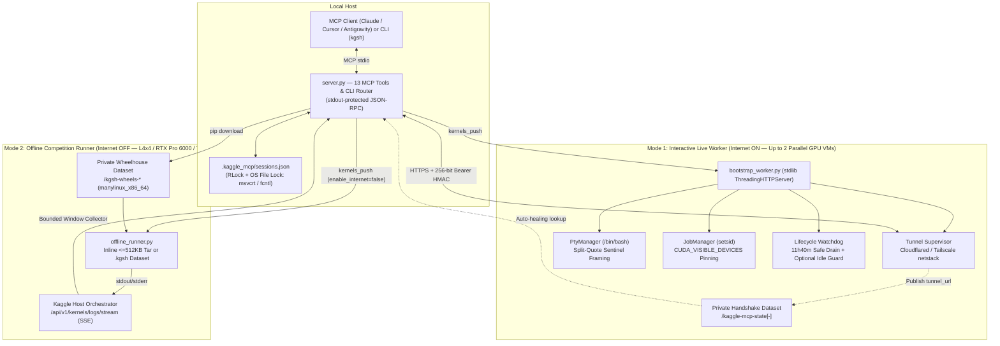

# Architecture of `kaggle-shell-mcp` (`kgsh`)

This document describes the container constraints of Kaggle Kernels, the dual-mode execution architecture of `kaggle-shell-mcp`, and the internal mechanisms that enable multi-slot live terminals and air-gapped competition execution over the Model Context Protocol (MCP).

---

## 1. Platform Constraints & Design Drivers

Kaggle's official `kernels_push` API executes non-interactive batch runs inside ephemeral, unprivileged Linux containers. Turning these containers into reliable, interactive GPU compute nodes for AI Agents requires designing around six hard platform constraints:

| Platform Constraint | Runtime Reality | Architectural Design in `kgsh` |
| :--- | :--- | :--- |
| **Inbound Firewall & Missing TUN** | All inbound ports are blocked; `/dev/net/tun` (`CAP_NET_ADMIN`) is unavailable | Outbound reverse tunnels (`cloudflared` Quick Tunnel by default; optional `tailscaled --tun=userspace-networking`) |
| **Hard Execution Ceilings** | **12 hours** for GPU/CPU commits; **9 hours** for TPU commits. Hard-killed runs lose `/kaggle/working` snapshots | In-container watchdog sends `SIGTERM` at `11h35m` (`8h35m` on TPU) and calls `sys.exit(0)` at `11h40m` (`8h40m` on TPU) |
| **Persistent vs. Ephemeral Disk** | `/kaggle/working` persists up to **~19.5 GB** on clean `exit(0)`; `/tmp` has larger scratch space but wipes on exit | Keep transient bundles/wheels in `/tmp`; reserve `/kaggle/working` strictly for logs, checkpoints, and final outputs |
| **CUDA Environment Inheritance** | `PATH`, `LD_LIBRARY_PATH`, and Conda paths are initialized on the kernel Python process, not system-wide `sshd` | Run a zero-dependency Python stdlib RPC + PTY daemon directly inside the kernel Python process (no `apt` / `openssh-server`) |
| **Concurrent GPU Session Limit** | Up to **2 concurrent GPU commit sessions** per Kaggle account, but a single kernel slug cannot track two live runs cleanly | Zero-contention **Slot Isolation** (`slot="1"`, `"2"`, ...) with dedicated kernel slugs, dedicated state datasets, and OS file locking |
| **Air-Gapped Competition GPUs** | High-tier competition shapes (`NvidiaL4x4`, `NvidiaRtxPro6000`) often enforce `enable_internet: false` | **Dual-Mode Engine**: falls back to offline wheelhouse + atomic code bundling and streams live logs via Kaggle's **Host SSE** endpoint |

---

## 2. System Architecture

`kaggle-shell-mcp` combines **Mode 1 (Interactive Live Worker)** for rapid R&D/debugging and **Mode 2 (Offline Competition Runner)** for air-gapped hardware inside a single MCP server and CLI.



---

## 3. Core Mechanisms

### 3.1. Zero-Contention Multi-Slot Isolation (`config.py`, `launcher.py`)
Running two GPU sessions simultaneously on one Kaggle account fails if both sessions share a single kernel slug or state dataset. `kaggle-shell-mcp` isolates every resource by a normalized `slot` identifier (`"1"`, `"2"`, `"comp-1"`, etc.):

- **Backward-Compatible & Run-Scoped Naming**:
  - `slot="1"` (default) maps to `<user>/kaggle-mcp-worker` and `<user>/kaggle-mcp-state`.
  - Any additional `slot="<id>"` maps to `<user>/kaggle-mcp-worker-<id>` and `<user>/kaggle-mcp-state-<id>`.
  - Offline batch runs allocate an isolated **Run-Scoped Slug** (`<user>/kgsh-batch-<slot>-<run6>`) so cancelling a queued/faulty run via `kernels_delete` never touches outputs from earlier runs.
- **Provisioning Persistence & 3-Tier Verified Shutdown**: `launch_worker` persists `ActiveSession(status="provisioning")` immediately after `kernels_push` (cleaning up temporary `build_bundle_*` files in `finally:`) and resumes waiting if re-invoked while the kernel is `QUEUED`/`RUNNING`. `shutdown_slot` verifies stop status across three tiers (in-band `/shutdown` -> out-of-band status check -> optional ephemeral `kernels_delete`) and refuses to wipe `sessions.json` if a GPU VM remains active.
- **Cross-Process Atomic State Store**: Access to `.kaggle_mcp/sessions.json` (`0700` dir / `0600` files on POSIX) is serialized by both an in-process `threading.RLock` and an OS-level byte-range/advisory lock (`msvcrt.locking` on Windows, `fcntl.flock` on POSIX) plus atomic temp-file rename (`os.replace`).

### 3.2. Zero-Setup Tunnel & Auto-Healing Handshake (`worker_template.py`, `client.py`)
1. On `kaggle_up`, the local launcher generates a fresh 12-byte `session_id` and a 32-byte (256-bit) `worker_token`, base64-encodes the bootstrap configuration into `worker_template.py`, and pushes the private script kernel.
2. Inside Kaggle, `cloudflared_supervisor` atomically downloads `cloudflared-linux-amd64` into `/tmp/kaggle_mcp_runtime`, opens a tunnel to `http://127.0.0.1:8765` (automatically switching from QUIC to `--protocol http2` after 2 quick QUIC failures), parses the `https://*.trycloudflare.com` URL, and publishes `state.json` to `<user>/kaggle-mcp-state[-<slot>]`.
3. Mutating `POST` requests carry an `X-Idempotency-Key` header backed by an in-worker `IdempotencyRegistry` and never blindly re-POST on read timeouts—preventing duplicate training processes on transient network stalls.

### 3.3. Stateful PTY Isolation & Echo-Immune Sentinel Framing (`worker_template.py`)
Agent tool calls and human TUI commands execute in isolated persistent `/bin/bash` PTY sessions (`"default"` for MCP/CLI, `"tui"` for `kgsh ui`), preventing `cwd` collisions or cross-session `SIGINT` interrupts:
- `PtySession` allocates a Linux pseudo-terminal (`pty.openpty()`) configured to `40×160` (`TIOCSWINSZ`) with `stty -echo`, `TERM=dumb`, bounded head/tail output buffers, and child-environment secret scrubbing (`_scrubbed_child_env`).
- Every command appends a split-quote `printf` sentinel:
  ```bash
  __mcp_ec=$?; printf '\n__MCP_END_%s__:%d:%s\n' '<half1>''<half2>' "$__mcp_ec" "$PWD"
  ```
  Because the input contains single quotes splitting the UUID in half while `printf` emits the concatenated UUID, terminal echo (even if re-enabled by a child binary) can never prematurely trigger sentinel detection.
- `PtyManager.interrupt(session)` scopes `SIGINT` (`\x03`) strictly to the named session, and `/monitor` exposes `pty_sessions_live` per session.

### 3.4. Detached GPU Jobs & Context-Window Protection (`worker_template.py`)
Long training runs should never be tied to an HTTP request lifetime:
- `JobManager.spawn` starts commands in a new process group (`start_new_session=True`), optionally pinning `CUDA_VISIBLE_DEVICES=<gpu_ids>` per job, and redirects output to `/kaggle/working/mcp_logs/<job_id>.log`.
- Combining `slot="1,2"` (`2 VMs × 2 Tesla T4 GPUs`) with `gpu_ids="0"` / `"1"` lets an Agent run **4 isolated 15 GB GPU jobs simultaneously**; `job_kill` signals the entire process group (`os.killpg`) so child `torchrun` workers release VRAM cleanly.
- `clean_tqdm` collapses intermediate carriage-return (`\r`) frames and strips ANSI cursor-movement sequences before returning logs over MCP, preventing `tqdm` progress bars from flooding LLM context windows.

### 3.5. Offline Competition Engine & Bounded Host SSE (`batch.py`)
When targeting restricted competition accelerators (`NvidiaL4x4`, `NvidiaRtxPro6000`) where `enable_internet: false` blocks outbound tunnels:
1. **Linux Wheelhouse (`kaggle_wheelhouse`)**: Downloads `manylinux2014_x86_64` / `manylinux_2_28_x86_64` binary `.whl` files matching the target CPython ABI (`cp312` / `cp313`) from any host OS (including Windows) and uploads them as a reusable private Kaggle Dataset.
2. **Atomic Code Delivery (`kaggle_batch_run`)**:
   - Source bundles `<= 512 KB` compressed are embedded directly inside `offline_runner.py` as base64—eliminating dataset creation latency and indexing races completely.
   - Larger bundles (`> 512 KB`) are uploaded to a private Dataset with a `.kgsh` extension (preventing Kaggle's GCS ingestion pipeline from auto-extracting `.tar.gz` archives) and verified via `dataset_list_files` before pushing the kernel.
   - At runtime, `offline_runner.py` extracts code into `/tmp/kgsh_batch_work`, records a baseline snapshot, and automatically harvests any newly created or modified outputs (`submission.csv`, `checkpoints/`) into `/kaggle/working` (`os.sync()`) inside a `finally:` block before exiting.
3. **Bounded Host SSE Log Reader (`collect_stream_window`, `merge_sse_log_snapshot`)**:
   - Kaggle's host-level `GET /api/v1/kernels/logs/stream/{owner}/{slug}` streams container stdout over Server-Sent Events (`text/event-stream`) even when container networking is disabled, but blocks until kernel completion.
   - `collect_stream_window` runs the SSE generator on a daemon thread feeding a `queue.Queue` with a bounded window (`wait_sec`) and early idle break (`idle_break_sec`), closes the underlying HTTP socket cleanly, and stitches cumulative/overlapping chunks via `merge_sse_log_snapshot` without $O(N^2)$ duplication.

### 3.6. Stdout Purity & Security Boundaries
- **MCP `stdio` Integrity**: Third-party SDKs (`kaggle>=2.2.0` / `kagglesdk`) occasionally print warnings or URLs to `sys.stdout`, which would corrupt MCP JSON-RPC frames. Every SDK import and API call in `launcher.py` and `batch.py` executes inside `contextlib.redirect_stdout(sys.stderr)`.
- **Constant-Time Auth, Sandbox & Archive Safety**: All worker endpoints (except minimal `/ping` session-ID probes) verify `Authorization: Bearer <worker_token>` via `hmac.compare_digest`. File endpoints enforce `_assert_writable_path` (protecting `/kaggle/input` and `/tmp/kaggle_mcp_runtime`), archive packers exclude `.env*`/`kaggle.json`/private keys by default, extractors enforce `Path.is_relative_to`, symlink-parent checks, and a `2 GiB` extraction ceiling, and `tui_bin.py` enforces **Fail-Closed** `SHA256SUMS.txt` verification.

---

## 4. Module Map

```text
kaggle-shell-mcp/
├── pyproject.toml                     # Package metadata & CLI entrypoints (kgsh, kaggle-shell-mcp, kaggle-mcp)
├── ARCHITECTURE.md                    # System architecture & protocol internals
├── README.md                          # English quickstart & reference
├── docs/README.vi.md                  # Vietnamese quickstart & reference
├── src/kaggle_mcp/
│   ├── __init__.py                    # Version & package metadata
│   ├── accelerators.py                # Hardware alias resolver (T4, L4x4, RTX Pro 6000, H100, TPU, CPU) & caps
│   ├── activity.py                    # Local ~/.kaggle_mcp/activity.jsonl lifecycle stream for TUI visibility
│   ├── batch.py                       # Offline wheelhouse builder, batch runner & bounded Host SSE log reader
│   ├── bridge.py                      # JSON stdin/stdout bridge for Rust TUI -> Kaggle SDK & launcher calls
│   ├── client.py                      # Slotted HTTPS RPC client (/monitor, chunked logs, /fs/* & tunnel auto-heal)
│   ├── config.py                      # .env / kaggle.json loader & file-locked multi-slot sessions.json
│   ├── kaggle_hub.py                  # Kaggle Hub search, inspector, kernel logs/delete & CSV submission helpers
│   ├── launcher.py                    # Multi-slot live bootstrap builder, source validator & parallel launcher
│   ├── profiles.py                    # Atomic boot profile store (~/.kaggle_mcp/profiles.json)
│   ├── quota.py                       # Weekly GPU/TPU quota reader via native kagglesdk timedelta objects
│   ├── repl.py                        # Interactive SSH-style bash REPL (kgsh shell) & tail -f log follower
│   ├── server.py                      # 13 MCP tools + standalone kgsh CLI router
│   ├── sync.py                        # Filtered .tar.gz packer/unpacker with path-traversal guards
│   ├── tui_bin.py                     # Prebuilt kgsh-tui locator & GitHub Release SHA-256 auto-downloader
│   └── remote/
│       └── worker_template.py         # Zero-dep stdlib remote daemon (PTY, JobManager, EventBus, /fs/* & /monitor)
├── tui/                               # Native Rust 60-FPS Dual-Panel TUI Cockpit (kgsh-tui)
│   ├── Cargo.toml
│   └── src/
│       ├── main.rs                    # Event loop, adaptive polling, mouse capture & terminal restore guard
│       ├── app/                       # State, async dispatch, keyboard/mouse input, selection & unit tests
│       ├── ui/                        # Graphite minimalist dual-panel rendering, panes & modals
│       ├── worker.rs                  # Async reqwest HTTP client for slotted worker & /fs/* RPCs
│       ├── bridge.rs                  # Async tokio stdin/stdout caller for kaggle_mcp.bridge
│       ├── state.rs                   # Shared sessions.json / profiles.json / activity bus readers
│       └── file_icons.rs              # Graphite palette constants, single-width badges & line highlighting
└── tests/                             # Restructured offline pytest suite
    ├── conftest.py                    # Shared state_dir fixtures & AST runtime template loaders
    ├── test_config_and_profiles.py    # Auth, slots, locking, profiles, accelerators & quota
    ├── test_launcher_and_lifecycle.py # Bootstrap bundle, provisioning resume & 3-tier shutdown
    ├── test_client_and_sync.py        # Idempotency, 404 fallbacks, secret-safe tar & Fail-Closed TUI bin
    ├── test_batch_engine.py           # Offline runner auto-harvest, Host SSE & log overlap stitching
    ├── test_remote_worker.py          # Worker sandbox, smart inspect, env scrubbing & PTY isolation
    └── test_hub_bridge_and_mcp.py     # Kaggle Hub, activity spans, Rust JSON bridge & MCP stdio server
```
