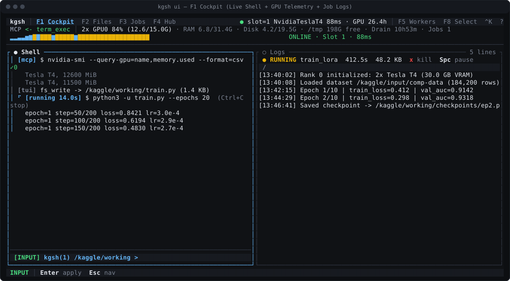
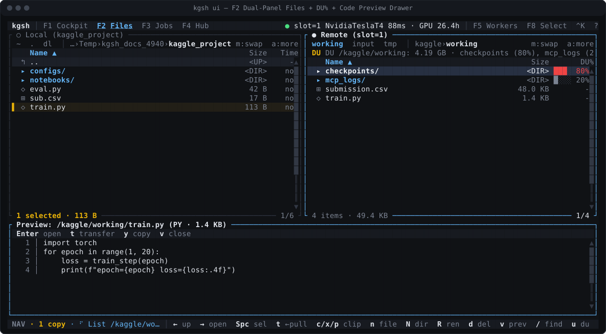
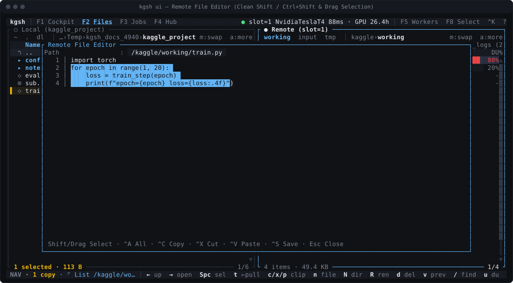
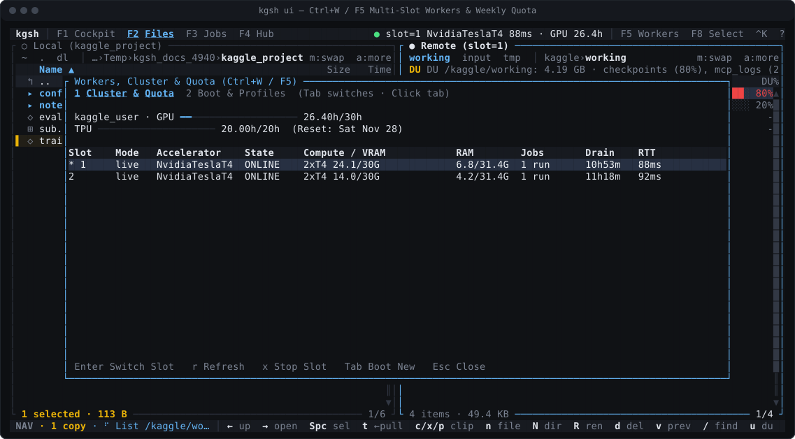

# kaggle-shell-mcp (`kgsh`) — Tài liệu Tiếng Việt

**Biến GPU Kaggle 12h miễn phí thành hệ thống Multi-Slot Live Terminal, File Manager 2 cột 60-FPS & Offline Competition Runner cho AI Agent qua MCP.**

[**English README**](../README.md) · [**Architecture**](../ARCHITECTURE.md) · [**Changelog**](../CHANGELOG.md) · [**Contributing**](../CONTRIBUTING.md)

---

## Ảnh chụp thực tế giao diện Rust TUI (`kgsh ui`)

### `F1` Cockpit — Shell trực tiếp, Telemetry GPU & Live Job Logs
Theo dõi theo thời gian thực mọi lệnh `[mcp]` do AI Agent thực thi song song với lệnh `[tui]` của bạn, % GPU/VRAM/RAM/Disk, output vòng lặp đang chạy và log tiến trình train.



### `F2` Dual-Panel File Manager & Code Preview Drawer
Quản lý song song thư mục Local (`Trái`) ⇄ Kaggle (`Phải`: `/kaggle/working`, `/kaggle/input`, `/tmp`) với phím điều hướng `←`/`→` kiểu Yazi nhớ vị trí con trỏ, cột `DU%`, multi-select, clipboard (`c`/`x`/`p`), `t` đồng bộ và `v` xem trước code.



<details>
<summary><strong>Xem thêm ảnh: Soạn thảo & Bôi chọn văn bản sạch · Quản lý Slot & Weekly Quota</strong></summary>

#### Trình sửa file (`Enter` / `→` 2 lần) — Bôi chọn bằng `Shift` / `Ctrl+Shift` & Chuột
Khi kéo chuột hoặc giữ `Shift` / `Ctrl+Shift` + mũi tên, trình soạn thảo và các vùng xem log/shell chỉ bôi & copy đúng **nội dung code/text sạch** — không dính nhãn `Path :`, cột số dòng `1 │ ` hay ký tự viền `│`.



#### Workers, Cluster & Quota (`Ctrl+W` / `F5`)
Xem số giờ Quota GPU (30h) & TPU (20h) hàng tuần, chuyển đổi / tắt các slot chạy song song và khởi chạy máy ảo từ Boot Profiles đã lưu.



</details>

---

## Cài đặt nhanh cho người mới (Không cần cài Rust)

### 1. Gắn cho AI Agent qua `uvx` (Claude Desktop / Cursor / Windsurf / Antigravity)

```json
{
  "mcpServers": {
    "kgsh": {
      "command": "uvx",
      "args": ["--from", "kaggle-shell-mcp", "kgsh"],
      "env": {
        "KAGGLE_USERNAME": "ten_tai_khoan_kaggle",
        "KAGGLE_KEY": "KGAT_token_cua_ban"
      }
    }
  }
}
```

### 2. Cài CLI + mở ngay Rust TUI (`pip` / `uv`)

```powershell
pip install kaggle-shell-mcp
# hoặc: uv tool install kaggle-shell-mcp
```

Điền `KAGGLE_USERNAME` và `KAGGLE_KEY` vào `.env` hoặc dùng sẵn `~/.kaggle/kaggle.json`, sau đó chạy:

```powershell
# Mở màn hình TUI Rust 60-FPS (lần đầu tự tải binary kgsh-tui dựng sẵn cho Windows, Linux x86_64/aarch64, macOS + kiểm tra SHA-256 Fail-Closed)
kgsh ui

# Hoặc thao tác trực tiếp bằng CLI:
kgsh quota
kgsh up -s 1
kgsh shell -s 1
```

### Điểm mới nổi bật trong bản `v1.0.1`
- **Hỗ trợ trọn vẹn Linux ARM64 (`aarch64` static `musl`) & Copy qua SSH (`OSC 52`)**: `kgsh ui` chạy mượt trên các máy chủ Ubuntu ARM64/x86_64 không có X11; `Ctrl+C`/`Ctrl+X`/`Ctrl+V` giữ nguyên văn bản qua `yank_buffer` nội bộ đồng thời đẩy clipboard về máy trạm qua chuỗi `OSC 52`.
- **Bảo vệ dữ liệu & chống rò rỉ 30h Quota GPU**: Tự động thu gom `submission.csv` và `checkpoints/` từ `/tmp` về `/kaggle/working` khi kết thúc Offline Batch; khóa `Read-Only` khi file từ xa lớn hơn `256 KB` bị cắt cụt; cảnh báo khi bấm `Esc` chưa lưu; và cơ chế tắt máy 3 tầng (`kgsh down [-f]`) không bao giờ xóa mù `sessions.json` khi GPU vẫn đang chạy.
- **Lọc tệp nhạy cảm tự động**: Chặn mặc định `.env`, `.env.*` (giữ `.env.example`), `kaggle.json`, khóa SSH/TLS và thư mục `kaggle_pull` khi đồng bộ lên Kaggle.

### 3. Build từ mã nguồn GitHub (Dành cho developer)

```powershell
git clone https://github.com/NguyenQuocDat06-AI/kaggle-shell-mcp.git
cd kaggle-shell-mcp
python -m venv .venv
.\.venv\Scripts\pip install -e ".[dev]"
cargo build --release --manifest-path tui/Cargo.toml
.\.venv\Scripts\kgsh ui
```

---

## Phím tắt cốt lõi trong `kgsh ui`

| Ngữ cảnh | Phím / Chuột | Chức năng |
| :--- | :--- | :--- |
| **Toàn cục** | `F1` / `F2` / `F3` / `F4` | Chuyển nhanh Preset: `Cockpit` · `Dual Files` · `Jobs & GPU` · `Kaggle Hub` |
| | `Tab` / `Alt+←` `Alt+→` | Đổi focus panel `TRÁI <-> PHẢI` |
| | `Ctrl+W` / `F5` / `Ctrl+K` / `?` | Quản lý Slot & Quota / Boot Profiles / Command Palette / Trợ giúp |
| | `z` / `m` / `a` / `T` | Phóng to 100% panel / Đổi nội dung panel / Menu ngữ cảnh / Ẩn-hiện Telemetry |
| | `F8` | Bật/tắt chế độ chuột TUI để bôi đen native của Windows Terminal |
| **Chọn & Copy** | `Shift` / `Ctrl+Shift` + `↑↓←→` | Bôi chọn văn bản sạch trong `FileEditor`, `Shell`, `Logs`, `PreviewDrawer` & ô nhập |
| | Kéo chuột trái | Bôi và tự copy nội dung sạch (tự cắt viền `│` và số dòng) |
| **Shell (`F1`)** | `i` / `Enter` · `:run <lệnh>` · `Alt+Enter` | Vào chế độ gõ lệnh · Chạy vòng lặp `for`/train stream output trực tiếp |
| **Files (`F2`)** | `←` / `→` · `Enter` · `v` | Lên thư mục cha (nhớ con trỏ) / Vào thư mục hoặc Preview (2× mở Editor) / Drawer |
| | `Space` / `Shift+A` / `t` / `c` `x` `p` | Đánh dấu / Chọn hết / Đẩy-kéo qua panel đối diện / Clipboard chéo |
| | `n` / `N` / `R` / `d` / `/` / `u` / `Shift+X` | Tạo file / Tạo thư mục / Đổi tên / Xóa (2×) / Tìm kiếm / `DU%` / Chạy script xem Live Logs |

---

## Quy trình mẫu 2 máy GPU & Competition khóa mạng

```powershell
# 1. Chạy song song 2 máy T4x2 (4 GPU = 60 GB VRAM) và chia 4 experiment
kgsh up -s 1,2
kgsh push .\my_app /kaggle/working -s 1
kgsh push .\my_app /kaggle/working -s 2
kgsh spawn -s 1 --gpus 0 "python my_app/train.py --seed 1" --name s1g0
kgsh spawn -s 1 --gpus 1 "python my_app/train.py --seed 2" --name s1g1
kgsh down -s all

# 2. Đẩy chạy Competition khóa mạng (L4x4 / RTX Pro 6000) & đọc live log qua Host SSE
kgsh wheels peft bitsandbytes --slug lora --py 312
kgsh batch-run "torchrun --nproc_per_node=4 train.py" --path .\solution -a rtx6000 --comp ten-cuoc-thi --wheels ten_ban/kgsh-wheels-lora
kgsh batch-logs -s batch-1 --tail 80
```
